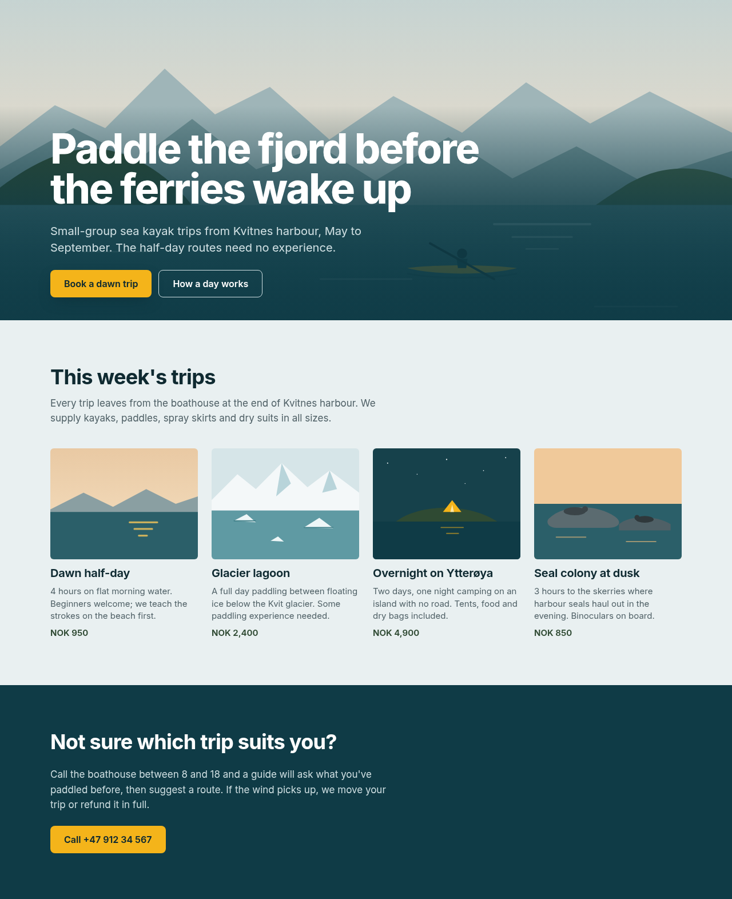
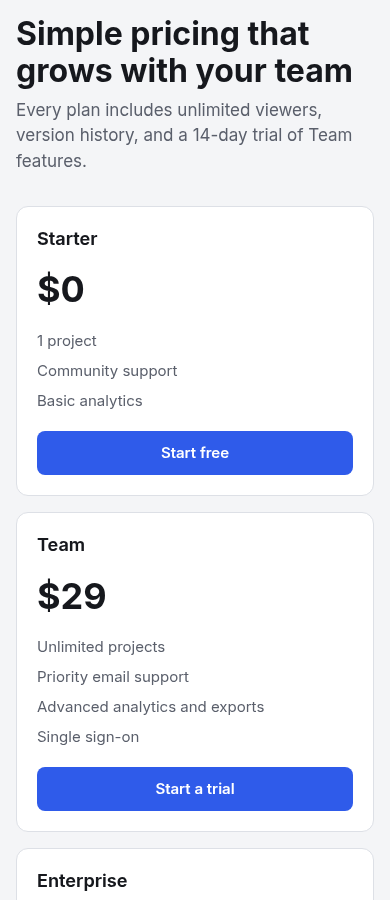
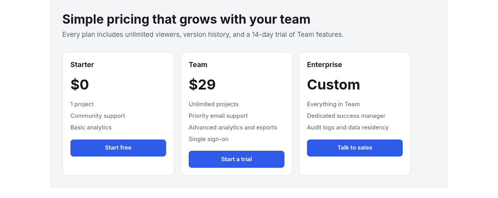

# Cadesa

[](https://github.com/soma-ck/cadesa/actions/workflows/ci.yml)
[](https://www.npmjs.com/package/cadesa)
[](LICENSE)

**Know what your layout does at every width before you open a browser.**

Point Cadesa at your coding agent (MCP) or at your existing CSS, and it tells you what breaks at 320px, what an edit will move three sections away, and where the design is muddled. It answers in milliseconds, as text, from a layout engine that runs without a browser and matches Chromium box for box.



<sub>Real output, generated by [`scripts/demo-svg.mjs`](scripts/demo-svg.mjs). The overflow it finds is real too: in Chromium the word is 248.14px wide in a 245px-wide card title at 1100px, and fits at 390, 768, 1024, 1280 and 1440px.</sub>

| 1280px | 390px |
| --- | --- |
|  |  |

<sub>[`examples/landing`](examples/landing): every one of its 5,412 boxes across 123 widths, line breaks included, was predicted without a browser and matches Chromium (`npm run conformance:landing`).</sub>

## Try it in 60 seconds

Install nothing: `npx` fetches it from npm on first use. Node 20 or newer.

**Give it to your agent.** Claude Code:

```sh
claude mcp add cadesa -- npx -y cadesa mcp
```

Cursor and other clients that take an `mcpServers` JSON config:

```json
{
  "mcpServers": {
    "cadesa": { "command": "npx", "args": ["-y", "cadesa", "mcp"] }
  }
}
```

The server's instructions teach the agent the render → explain → whatif → edit loop, so you can ask "check this page at every width from 320 to 1440px" or "what else moves if I change this?"

**Run it on CSS you already have.** Give it an HTML snapshot of the page and its stylesheet:

```console
$ npx -y cadesa check page.html --css styles.css --widths 320,390,768,1024,1280,1440
```

Here it is on [`fixtures/legacy.css`](fixtures/legacy.css), a hand-written BEM stylesheet:

```console
$ cadesa check fixtures/legacy.html --css fixtures/legacy.css --widths 390,1280
390px
  ⚠ [tap-target] #follow is 358×40px; 44×44px is recommended for touch (WCAG 2.5.5)
      edit: styles.profile-card.slots.follow.height
  ⚠ [tap-target] #message is 358×40px; 44×44px is recommended for touch (WCAG 2.5.5)
      edit: styles.profile-card.slots.message.height

1280px
  ? [tap-target] #follow is 75.7×40px; 44×44px is recommended for touch (WCAG 2.5.5) (inconclusive: this box isn't exactly predicted for the original CSS)
      edit: styles.profile-card.slots.follow.height
  ? [tap-target] #message is 133.55×40px; 44×44px is recommended for touch (WCAG 2.5.5) (inconclusive: this box isn't exactly predicted for the original CSS)
      edit: styles.profile-card.slots.message.height

0 errors, 4 warnings
```

Your CSS is converted to Cadesa on the fly ([lift](#already-have-css-lift-it)). Boxes it can't predict exactly, here because of a `min-width` media query at 1280px, are marked, and their findings say *inconclusive* instead of guessing. Lift works best on component CSS with class selectors (`.block`, `.block__element`); the more of your CSS it can't model, the more findings come back inconclusive. `data-fixture="name"` attributes in the HTML give boxes readable names. `render`, `whatif`, `explain` and `critique` take `--css` too.

**Or try the examples in this repo:**

```sh
git clone https://github.com/soma-ck/cadesa && cd cadesa && npm install
npx cadesa whatif fixtures/settings.html --source settings.cadesa.yaml \
  --set styles.settings-panel.when.narrow.padding=panel
```

<details>
<summary>Install notes: adding it to a project, running the latest commit</summary>

- To add it to a project: `npm i -D cadesa`, then `npx cadesa ...`.
- The latest commit from GitHub instead of the npm release: `npx -y --allow-git=all github:soma-ck/cadesa ...` (`--allow-git` is needed on npm 12, which refuses git dependencies by default; npm may warn that the `prepare` script was blocked, but it has already built the package).
- From a local checkout: `npm run build:ts && claude mcp add --scope user cadesa -- node /path/to/cadesa/lib/cli.js mcp`. This repo's [`.mcp.json`](.mcp.json) runs the server from source.
- No browser is needed for anything except `cadesa metrics` and the conformance suites.

</details>

## What it found on a real site

An agent rebuilt a 20-component French-language WordPress site in Cadesa, checking every edit at 12 or more widths. Its two field reports describe bugs nobody had asked it to look for, most of them visible only at some widths:

- A long word overflowing a card by **7.4px, only at 1100, 1280 and 1440px**.
- A link **23.8px tall**, 0.2px under the WCAG 2.5.8 minimum of 24px.
- Lines over 80 characters, **only at tablet widths**.
- An overflow at **300px** introduced by a cleanup, and nav links shrinking to **42.9px**.
- `whatif` stopped a fix to one card from **collapsing the footer from 4 columns to 3, three sections away**: footer height 437 → 682px.
- `critique` flagged **15 font sizes**, several only 1.08× apart. Consolidating to 7 visibly sharpened the hierarchy.

Each check took 60–900ms. At that cost, checking every edit at a dozen widths stopped being a chore and became the normal way to work.

The same rebuild found seven cases where Cadesa said "fine" and Chromium disagreed: four layout divergences (image `width`/`height` attributes, no-break spaces, nested centered layers, block children measured as one line) and three gaps in the checks. All seven are fixed and kept as regression tests ([`fixtures/field2.html`](fixtures/field2.html), `npm run conformance:field2`).

## What it does

| Command / MCP tool | Question it answers |
| --- | --- |
| `whatif` · `cadesa_whatif` | If I make this edit, what moves at each width, and does anything regress? Runs in memory and writes nothing. |
| `check` · `cadesa_check` | Is anything overflowing, too small to tap, low contrast, or too long to read comfortably, at any of these widths? |
| `critique` · `cadesa_critique` | Does it read as designed: type scale, hierarchy, grouping, alignment, palette? |
| `explain` · `cadesa_explain` | Why is this value what it is, and which line do I edit? |
| `render` · `cadesa_render` | Where is every box, and where does every line of text wrap? |
| `lift` · `cadesa_lift` | Convert existing CSS. What couldn't be converted, and which boxes does that affect? |
| `validate` / `build` · `cadesa_validate` / `cadesa_css` / `cadesa_build` | Validate the source, preview the CSS, write the CSS. |

Add `--json` to any command for machine-readable output. Every MCP read tool accepts `sourceText`, so an agent can evaluate an unsaved draft, or `css` to work on existing CSS.

### whatif: see an edit's effect before making it

```console
$ cadesa whatif fixtures/settings.html --source settings.cadesa.yaml \
    --set styles.settings-panel.when.narrow.padding=panel
whatif styles.settings-panel.when.narrow.padding: compact → panel
(in memory, nothing written · computed in 26ms, no browser)

390px · narrow active
  #panel       padding 16px → 32px
                 ← space.panel = 2rem ← when.narrow (390px ≤ 576px) ← styles.settings-panel.when.narrow.padding
               h 232.8 → 264.8
  #title       x 16 → 32  y 16 → 32  w 358 → 326
  #description x 16 → 32  y 68.8 → 84.8  w 358 → 326
  #actions     x 16 → 32  y 116.8 → 132.8  w 358 → 326
  #save        x 16 → 32  y 116.8 → 132.8  w 358 → 326
  #cancel      x 16 → 32  y 172.8 → 188.8  w 358 → 326

1280px
  ✓ unchanged: no box moved, no property changed
```

One proposed edit, every affected box, the source path that explains each value, and proof that desktop didn't move. An agent can read that and decide *before* it touches a file.

### check: find what breaks, and at which width

```console
$ cadesa check examples/pricing/pricing.html --source examples/pricing/pricing.cadesa.yaml \
    --widths 320,390,768,1024,1280,1440
768px
  ⚠ [line-length] #lede has lines up to 82 characters at 768px; 45–75 reads comfortably
      edit: styles.pricing.slots.lede

0 errors, 1 warning
```

`check` covers overflow (horizontal, unbreakable words, and text taller than a fixed height), tap targets (WCAG 2.5.8 and 2.5.5), text contrast against the nearest known background, including every stop of a gradient, and line length. When it can't decide, for example because text sits over an image or the page background is outside Cadesa, it says *inconclusive* rather than guessing.

With `muted` lightened to `#aab0bb`:

```console
$ cadesa check fixtures/settings.html --source settings.cadesa.yaml --widths 1280
1280px
  ✖ [contrast] #description text #aab0bb on #ffffff is 2.18:1; WCAG AA needs 4.5:1 (background from styles.settings-panel.background)
      edit: text.body-muted.color
```

### critique: measurable design signals

`check` asks whether the page is broken. `critique` asks whether it reads as designed, using signals measured from the source and the box tree rather than from taste:

```console
$ cadesa critique fixtures/settings-long.html --source settings.cadesa.yaml
◇ [type-scale] font sizes 15, 16px are within 1.07× of each other, too close to read as different levels
  (body-muted 16, label 15, label-inverse 15); use one size for that level, or make a real step (≥1.2×)
◇ [palette] every color in use is a grey, near-black or near-white (#ffffff, #191b20, #555964); with no hue
  anywhere the page reads as unbranded. One accent, from the subject, on the main action is usually enough
```

| Signal | What it measures |
| --- | --- |
| `type-scale` | bands of font sizes within 1.12× of each other: they read as one level |
| `hierarchy` | a heading less than 1.25× larger (and not clearly heavier) than the text under it |
| `grouping` | a group whose inner gap isn't smaller than the gap around it (proximity) |
| `alignment` | page-column text edges that *almost* line up (2–48px apart), or more than three edges |
| `palette` | no hue anywhere (an unbranded page), or several accent colors competing on actions |
| `tells` | small tracked uppercase labels, `A · B · C` meta strings, `→` appended to actions |

Findings are suggestions with numbers and a source path, not errors. Taste stays with you or your agent. The landing example above has no findings; the settings panel is genuinely unbranded and gets two.

### explain: why a value is what it is

```console
$ cadesa explain fixtures/settings.html --source settings.cadesa.yaml --id panel --widths 1280
#panel <section> at 1280px
  box 320,0 640×208.8 · style styles.settings-panel

  padding     32px
                set at styles.settings-panel.padding
                  from space.panel = 2rem
                ○ when.narrow (max-width: 36rem (576px)): compact (16px)  styles.settings-panel.when.narrow.padding
  ...
```

`○` marks an override that isn't active at this width but would take over below 576px.

### render --lines: where text wraps

```console
$ cadesa render fixtures/settings-long.html --source settings.cadesa.yaml --widths 390 --lines
    #description  p        16,97.6   358×120    text body-muted · 5 lines
                  │ We’ll email you when someone joins, leaves, or  (354.87px)
                  │ changes billing details — plus a weekly  (295.56px)
                  │ summary of everything else that happened  (324.4px)
                  │ across your organization’s projects,  (267.78px)
                  │ integrations, and long-running deployments.  (335.12px)
```

## Benchmarks

### Speed: 25× faster than driving a browser

The same job done two ways: get every box of the landing page at every width. On one laptop core (Ryzen 5 PRO 5675U), both sequential, both producing the same boxes:

| Job | Cadesa engine | Playwright + Chromium |
| --- | --- | --- |
| [`examples/landing`](examples/landing), 113 widths (320–1440px, every 10px) | **0.44s** | 9.16s |
| Same page, **every pixel** from 320 to 1440 (1,121 widths, 49,324 boxes) | **3.5s** | 88.4s |
| [`examples/pricing`](examples/pricing), 113 widths | **0.24s** | 5.56s |

About 3ms per width instead of about 79ms, with no browser to download or launch. That speed is why an agent can check every width on every edit instead of two or three screenshots at the end, and why a CI job can sweep every pixel width in seconds. Reproduce it with `npm run speed` (`-- --step 1` for every pixel).

The comparison covers layout geometry only: where every box lands and how text wraps. Pixel diffs, hover states and interaction tests still need a browser.

All benchmark code, earlier agent runs and raw data are in [`bench/`](bench/) ([`RESULTS.md`](bench/RESULTS.md)).

## How exact is "exact"?

There are two separate claims:

1. **The engine is the spec.** Cadesa's box tree is defined by its reference engine ([`src/engine/`](src/engine/)). It is deterministic and depends only on source, HTML and width.
2. **Chromium agrees, verified rather than assumed.** Each conformance suite builds the CSS, loads the page in Chromium, checks that it loaded those exact bytes, and compares every box against the engine, including how many lines each text wraps to. All of them run in CI.

| Suite | What it covers | Boxes that agree with Chromium |
| --- | --- | --- |
| `npm run conformance` | 2 fixtures × 4 widths | 48 of 48 |
| `npm run conformance:sweep` | long copy at every 3px from 260 to 1000px, so widths land on line-break boundaries | 1,482 of 1,482 over 247 widths |
| `npm run conformance:pricing` | nested components | 4,290 of 4,290 over 143 widths |
| `npm run conformance:landing` | grid, layered text over images, aspect ratios, gradients | 5,412 of 5,412 over 123 widths |
| `npm run conformance:field2` | every divergence found in real use, kept fixed | 1,428 of 1,428 over 102 widths |
| `npm run conformance:lift` | lifted hand-written CSS vs. the original | 15 of 15 boxes marked exact matched; 17 of 17 marked uncertain really differed |

"Agree" means x, y, width and height all within 0.5px, so a text that wrapped to a different number of lines would fail by a whole line height. The differences in the sample below are about 0.01px. Agreement is with the fixtures above. In real use, Cadesa has said "fine" where Chromium disagreed seven times so far: four layout divergences and three check gaps ([above](#what-it-found-on-a-real-site)). Each one is fixed and became a regression test.

```
── fixtures/settings-long.html
320px (narrow active)
  ✓ #panel        0,0 320×410.4              0,0 320×410.39             0.009
  ✓ #title        16,16 288×86.4             16,16 288×86.39            0.009  3 lines / chromium 3
  ✓ #description  16,126.4 288×144           16,126.39 288×144          0.009  6 lines / chromium 6
  ...
✓ stylesheet: the fixture loaded dist/settings.css unchanged
✓ engine and Chromium agree on all 48 boxes
```

### How text is measured without a browser

Cadesa bundles [Inter](https://rsms.me/inter/) (SIL OFL 1.1) and a 136 KB metrics table: glyph advances and 13k kerning pairs, sampled at 9 weights and interpolated. `npm run metrics` regenerates the table, once, from Chromium's own text measurement. At runtime the engine reads only the JSON, with no font parser and no browser. Line breaking follows CSS `white-space: normal`: breaks after spaces, after hyphens between letters, and around dashes; no-break spaces never break. Each component's reset pins the inherited text properties that could change line breaks (letter-spacing, word-spacing, text-transform, kerning and so on), so a host page can't change them behind the engine's back.

### Your own fonts

```sh
npm i -D playwright                     # only needed for this one-time step
cadesa metrics fonts/BrandSans.woff2 --family "Brand Sans"                 # variable font
cadesa metrics fonts/Brand-Regular.ttf --family "Brand Sans" --weight 400  # or one static face at a time
cadesa metrics fonts/Brand-Bold.ttf    --family "Brand Sans" --weight 700
```

This measures the font once in Chromium and writes `.cadesa/metrics/brand-sans.metrics.json`. Commit that file, and the engine measures text set in `"Brand Sans"` from then on, with no browser. Static faces are matched by CSS weight rules: a 650 role uses the 700 face. A weight the browser would synthesize, such as bold from a regular-only family, is flagged rather than guessed. Verified with Liberation Sans, using two static faces: all 1,482 boxes across the 247-width sweep agree with Chromium.

**Current limits:** a font without metrics, or a character outside the measured Latin set, falls back to a one-line assumption, and every report flags that box. In a `cluster`, a box without a width is sized to its text (max-content, shrinking to min-content), the same way flexbox does it. No hyphenation, no `text-wrap: balance`, and no bidirectional text yet.

The conformance run uses a system Chrome or Chromium when one is found (or `$CADESA_CHROME`), otherwise Playwright's bundled browser. A browser is never needed to build, render, explain, check, critique or `whatif`.

## Why a language

CSS layout is emergent: cascade, specificity, inheritance and intrinsic sizing all interact, so the usual way to know what an edit does is to render it in a browser. That answer comes *after* the edit, takes seconds, and arrives as pixels, which language models read poorly.

Cadesa is a styling language deliberately small enough to simulate exactly: no cascade, no inheritance, four layout patterns, and a named token for every value. That is what makes exact prediction possible, and why every number in a report can point at the line that produced it. It compiles to ordinary, readable CSS with no runtime.

```yaml
version: 1
tokens:
  space: { section: 1.5rem, panel: 2rem, compact: 1rem, control: 0.75rem }
  color: { surface: "#ffffff", ink: "#191b20", muted: "#555964" }
text:
  section-title: { size: 1.5rem, weight: 650, lineHeight: 1.2, color: ink }
breakpoints:
  narrow: 36rem
styles:
  settings-panel:
    intent: Give the heading and save action the strongest visual hierarchy.
    layout: { pattern: stack, gap: section }
    padding: panel
    slots:
      title: { text: section-title }
      actions: { layout: { pattern: cluster, gap: control } }
    when:
      narrow:
        padding: compact
        slots:
          actions: { layout: { pattern: stack, gap: control } }
```

The full example is in [`settings.cadesa.yaml`](settings.cadesa.yaml), and the CSS it compiles to is in [`dist/settings.css`](dist/settings.css). Add `# yaml-language-server: $schema=./schema/cadesa.schema.json` to get editor autocomplete.

### Errors point at the field to edit

```console
$ cadesa build settings.cadesa.yaml --out dist/settings.css
settings.cadesa.yaml:19:36 error styles.settings-panel.layout.gap: unknown space token "sectoin"
  expected: one of section, panel, compact, control
  got: "sectoin"
  did you mean "section"?
```

Invalid source never produces CSS. The same input always produces byte-identical CSS.

## Already have CSS? Lift it

`cadesa lift` converts plain BEM-style CSS (`.block`, `.block__element`) into a Cadesa source. Whatever doesn't fit isn't guessed. It is reported per box: for each width, which boxes the engine still predicts exactly, which may differ from the original CSS, and which declaration or browser default is responsible.

```console
$ cadesa lift fixtures/legacy.css --fixture fixtures/legacy.html --widths 390,1280 --out legacy.cadesa.yaml
lift fixtures/legacy.css: 49 of 54 declarations lifted · 1 component · 17 tokens · 1 breakpoint

box impact (≈ = may differ from the original CSS)
390px
  ✓ exact (5): #name #bio #actions #follow #message
  ≈ #meta size
      fixtures/legacy.css: <p> keeps the browser's default margin (no margin set); Cadesa's reset removes it
  ≈ #badge size+position
      fixtures/legacy.css:78 position: absolute: position: absolute takes the box out of normal flow
  · no effect in the default state: fixtures/legacy.css:59 background: #1d4ed8: interactive state
1280px
  ✓ exact (0): none
  ≈ #name size
      fixtures/legacy.css:106 max-width: 560px: @media (min-width: 1024px) is not modelled
  ...
```

A `:hover` rule can't move anything in the default state, while a `min-width` query moves every box at the widths where it applies. A coverage percentage would hide that difference, so lift reports per box instead.

Every read command and MCP tool also accepts `--css <file.css>` in place of `--source`. The CSS is lifted on the fly, uncertain boxes are marked `≈`, and `check` findings on them are reported as inconclusive. The `edit:` paths then refer to the lifted source, which `lift --out` writes.

**Verified against Chromium:** `npm run conformance:lift` loads the fixture with the *original* hand-written CSS. Every box lift marked exact matched, 15 of 15 at 0.000–0.011px. Every box it marked uncertain really did differ, 17 of 17. Lifting Cadesa's own output gives back the same source, and a test checks that its layout is identical at 49 widths.

## Language reference

| Key | Value | Compiles to |
| --- | --- | --- |
| `layout.pattern: stack` | | `display:flex; flex-direction:column; align-items:stretch` |
| `layout.pattern: cluster` | | `display:flex; flex-wrap:wrap; align-items:center` |
| `layout.pattern: grid` + `min` | size token | `grid-template-columns: repeat(auto-fill, minmax(min(<min>, 100%), 1fr))`. Columns fill the row, each at least `min` |
| `layout.pattern: layer` | | one grid cell holding every child: text over a photo, a badge over a card |
| `layout.gap` | space token | `gap` |
| `layout.align` | `start`, `center`, `end`, `stretch` | `align-items`. Cluster defaults to `center`, grid and layer to `stretch` (equal-height cards). Not for stack |
| `padding` | space token, or `{ block, inline }` | `padding` (a missing axis is 0) |
| `background`, `border` | color token | `background-color`, `border: 1px solid` |
| `backdrop` | paint token: gradients and `url()` | `background-image`, cover, centered. Paint only, never moves a box |
| `shadow` | shadow token | `box-shadow`. Paint only |
| `radius` | radius token | `border-radius` |
| `width` | size token, or `fill` | fixed `width; flex:none`, or stretch in a stack. Unset: stretch in a stack, sized to its text in a cluster |
| `height` | size token | `height` |
| `maxWidth` | size token | `width:100%; max-width; margin-inline:auto`: a centered column, e.g. the content inside a full-bleed band |
| `measure` | size token | `max-width`, left-aligned: a comfortable line length |
| `aspect` | `"16:9"` | `aspect-ratio`: the height follows the width (images, media) |
| `fit` | `cover`, `contain` | `object-fit`. Paint only |
| `text` | text role | font family, size, weight, line-height, color; optional `letterSpacing` (em), `transform: uppercase`, `decoration: none \| underline`. Spacing and case are measured exactly |
| `textAlign` | `start`, `center`, `end` | `text-align`. A text box with a fixed `height` also centers its lines vertically (`align-content: center`) |
| `when.<breakpoint>` | any of the above, plus `slots` | `@media (max-width: …)` after base rules. Each property listed replaces its base value; unlisted properties keep their base value. `layout` and `padding` are replaced as a whole. The narrowest active breakpoint wins |
| `intent` | sentence | a CSS comment; metadata for inspection |
| `page.background` (top level) | color token | `:root { background-color }`; makes contrast checks conclusive |

**Components nest.** Any element can be the root of another component. Put a `.ca-plan-card` inside `.ca-pricing__plans` and the parent slot's layout places it, while the card lays out its own slots, breakpoints and all. Repeated elements share their slot's style (three `.ca-plan-card__feature` items, say). See [`examples/pricing`](examples/pricing):

| 390px | 1280px |
| --- | --- |
|  |  |

<sub>All 4,290 boxes agree with Chromium across 143 widths (`npm run conformance:pricing`).</sub>

Class contract: `.ca-<component>` on the root and `.ca-<component>__<slot>` on slots. Set a top-level `prefix: ""` to drop the `ca-` (lift does this to keep existing class names). Slot rules are scoped to the root. Each component gets a scoped reset, so browser defaults can't move boxes the engine doesn't know about.

## Using the CSS in your app

The stylesheet is plain CSS. Here it is on a minimal Vue component ([`examples/vue/SettingsPanel.vue`](examples/vue/SettingsPanel.vue)):

```vue
<script setup lang="ts">
import "./settings.css";
defineEmits<{ save: []; cancel: [] }>();
</script>

<template>
  <section class="ca-settings-panel" aria-labelledby="notifications-title">
    <h2 id="notifications-title" class="ca-settings-panel__title">Email notifications</h2>
    <p class="ca-settings-panel__description">Pick what lands in your inbox.</p>
    <div class="ca-settings-panel__actions">
      <button class="ca-settings-panel__primary" type="submit" @click="$emit('save')">Save changes</button>
      <button class="ca-settings-panel__secondary" type="button" @click="$emit('cancel')">Cancel</button>
    </div>
  </section>
</template>
```

React, Svelte, server templates and static HTML work the same way, because Cadesa has no runtime.

## Roadmap

- **Tailwind:** read utility classes (`flex gap-4 p-6 md:grid-cols-3`) straight from a page's HTML, so Tailwind apps get `check`, `whatif` and `critique` without writing any Cadesa source.
- **More of CSS:** `min-width` and range breakpoints, a `row` pattern and shared flexible widths, so lift leaves less behind.
- **A differential fuzzer** that generates random pages and compares the engine against Chromium, to find divergences before users do.
- **A discovery benchmark:** agents make a site-wide change without being told where it breaks; count the defects that ship across every width and the regressions in untouched sections.

## Development

```sh
npm test             # validation, determinism, golden CSS, engine, whatif
npm run typecheck
npm run build:ts           # also runs on npm install (prepare)
npm run conformance        # optional: engine vs. Chromium, 2 fixtures × 4 widths
npm run conformance:sweep  # optional: 247 widths, line-break boundaries
npm run conformance:lift   # optional: lifted hand-written CSS vs. the original in Chromium
npm run conformance:pricing # optional: nested components, 143 widths
npm run conformance:landing # optional: the landing page, 123 widths
npm run conformance:field2  # optional: every engine divergence found in real use, kept fixed
npm run bench              # optional: agent benchmark (uses the claude CLI and model usage)
node scripts/demo-svg.mjs  # regenerate docs/demo.svg from real CLI output (after build:ts)
```

## License

Cadesa's own source code is [MIT](LICENSE). The bundled Inter font is under the [SIL Open Font License 1.1](fonts/OFL.txt).

**The CSS you generate is yours.** Running the compiler does not place your `.cadesa.yaml` sources or the CSS it emits under the MIT license or any other Cadesa license. License your output however you like, including proprietary.
