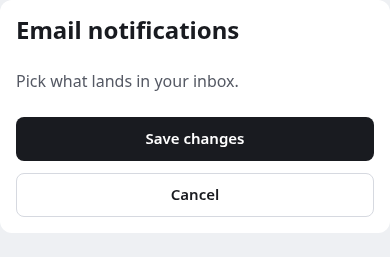
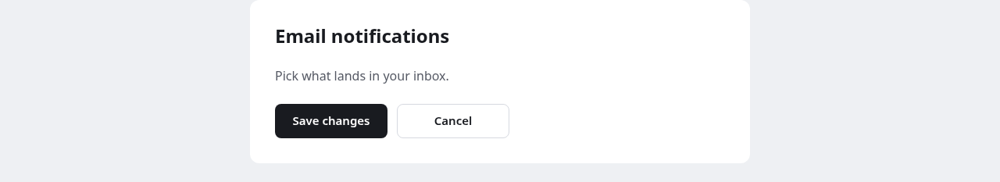

# Cascadio

**Predict what a style edit will do before you make it.**
Cascadio computes layout without a browser and ships plain CSS.

```console
$ cascadio whatif fixtures/settings.html --source settings.cascade.yaml \
    --set styles.settings-panel.when.narrow.padding=panel

whatif styles.settings-panel.when.narrow.padding: compact → panel
(in memory, nothing written · computed in 22ms, no browser)

390px · narrow active
  #panel       padding 16px → 32px
                 ← space.panel = 2rem ← when.narrow (390px ≤ 576px) ← styles.settings-panel.when.narrow.padding
               h 232.8 → 264.8
  #title       x 16 → 32  y 16 → 32  w 358 → 326
  #description x 16 → 32  y 68.8 → 84.8  w 358 → 326
  #actions     x 16 → 32  y 116.8 → 132.8  w 358 → 326
  #save        x 16 → 32  y 116.8 → 132.8  w 358 → 326
  #cancel      x 16 → 32  y 172.8 → 188.8  w 358 → 326

1280px
  ✓ unchanged: no box moved, no property changed
```

One proposed edit, every affected box, the YAML path that explains each value, and proof that desktop didn't move. An agent can read that and decide *before* it touches a file.

| 390px | 1280px |
| --- | --- |
|  |  |

<sub>Screenshots are from the Chromium conformance run, loading the exact CSS bytes `cascadio build` wrote.</sub>

## Why

Agents write CSS blind. CSS layout is emergent (cascade, specificity, inheritance, intrinsic sizing), so the only way to know what an edit does is to render it in a browser. That answer comes *after* the edit, takes seconds, and arrives as pixels that language models read poorly.

Cascadio is a styling language deliberately small enough to simulate exactly: no cascade, no inheritance, two layout patterns, and named tokens for every value. Its reference engine is a few hundred lines of TypeScript. It answers in milliseconds as **text**: box geometry, the provenance chain for each value, and a diff between before and after.

Production gets ordinary, readable CSS with no runtime.

## Quick start

```sh
npm install
npm run cascadio -- build settings.cascade.yaml --out dist/settings.css
npm run cascadio -- render fixtures/settings.html --source settings.cascade.yaml --widths 390,1280
npm run cascadio -- whatif fixtures/settings.html --source settings.cascade.yaml --widths 390,1280 \
  --set styles.settings-panel.when.narrow.padding=panel
```

Add `--json` to any command for machine-readable output.

## The source

```yaml
version: 1
tokens:
  space: { section: 1.5rem, panel: 2rem, compact: 1rem, control: 0.75rem }
  color: { surface: "#ffffff", ink: "#191b20", muted: "#555964" }
text:
  section-title: { size: 1.5rem, weight: 650, lineHeight: 1.2, color: ink }
breakpoints:
  narrow: 36rem
styles:
  settings-panel:
    intent: Give the heading and save action the strongest visual hierarchy.
    layout: { pattern: stack, gap: section }
    padding: panel
    slots:
      title: { text: section-title }
      actions: { layout: { pattern: cluster, gap: control } }
    when:
      narrow:
        padding: compact
        slots:
          actions: { layout: { pattern: stack, gap: control } }
```

The full example is in [`settings.cascade.yaml`](settings.cascade.yaml), and the CSS it compiles to is in [`dist/settings.css`](dist/settings.css). Add `# yaml-language-server: $schema=./schema/cascadio.schema.json` to get editor autocomplete.

### Errors point at the field to edit

```console
$ cascadio build settings.cascade.yaml --out dist/settings.css
settings.cascade.yaml:19:36 error styles.settings-panel.layout.gap: unknown space token "sectoin"
  expected: one of section, panel, compact, control
  got: "sectoin"
  did you mean "section"?
```

Invalid source never produces CSS. The same input always produces byte-identical CSS.

## Language reference (v1)

| Key | Value | Compiles to |
| --- | --- | --- |
| `layout.pattern: stack` | | `display:flex; flex-direction:column; align-items:stretch` |
| `layout.pattern: cluster` | | `display:flex; flex-wrap:wrap; align-items:center` |
| `layout.gap` | space token | `gap` |
| `padding` | space token | `padding` |
| `background`, `border` | color token | `background`, `border: 1px solid` |
| `radius` | radius token | `border-radius` |
| `width` | size token, or `fill` | fixed `width; flex:none`, or stretch in a stack |
| `height` | size token | `height` |
| `maxWidth` (root only) | size token | `max-width; margin-inline:auto` |
| `text` | text role | font family, size, weight, line-height, color |
| `when.<breakpoint>` | any of the above, plus `slots` | `@media (max-width: …)` after base rules; replaces, never merges |
| `intent` | sentence | a CSS comment; metadata for inspection |

Class contract: `.ca-<component>` on the root and `.ca-<component>__<slot>` on slots. Slot rules are scoped to the root. Each component gets a scoped reset, so browser defaults can't move boxes the engine doesn't know about.

## How exact is "exact"?

There are two separate claims:

1. **The engine is the spec.** Cascadio's box tree is defined by its reference engine ([`src/engine/layout.ts`](src/engine/layout.ts)). It is deterministic and depends only on source, fixture and width.
2. **Chromium agrees, verified rather than assumed.** `npm run conformance` builds the CSS, serves the fixture, checks that the page loaded those exact bytes, and compares every `data-fixture` box against the engine:

```
390px (narrow active)
  ✓ #panel        0,0 390×232.8              0,0 390×232.8              0.003
  ✓ #title        16,16 358×28.8             16,16 358×28.8             0.003  (text: 1 line assumed)
  ✓ #description  16,68.8 358×24             16,68.8 358×24             0.003  (text: 1 line assumed)
  ✓ #actions      16,116.8 358×100           16,116.8 358×100           0.003
  ✓ #save         16,116.8 358×44            16,116.8 358×44            0.003
  ✓ #cancel       16,172.8 358×44            16,172.8 358×44            0.003
1280px
  ✓ … all 6 boxes, max Δ 0.003px
✓ stylesheet: the fixture loaded dist/settings.css unchanged
✓ engine and Chromium agree on every box
```

(The 0.003px is Chromium's 1/64px layout rounding.)

**Current limits (Stage A):** the engine does not measure text yet. A text box is assumed to be one line tall (`size × lineHeight`), and every report flags this. A box in a `cluster` needs a token width. Wrapping text and content-sized boxes arrive with Stage B: a bundled font and line-count conformance.

The conformance run uses a system Chrome or Chromium when one is found (or `$CASCADIO_CHROME`), otherwise Playwright's bundled browser. A browser is never needed to build, render or `whatif`.

## Using the CSS in your app

The stylesheet is plain CSS. Here it is on a minimal Vue component ([`examples/vue/SettingsPanel.vue`](examples/vue/SettingsPanel.vue)):

```vue
<script setup lang="ts">
import "./settings.css";
defineEmits<{ save: []; cancel: [] }>();
</script>

<template>
  <section class="ca-settings-panel" aria-labelledby="notifications-title">
    <h2 id="notifications-title" class="ca-settings-panel__title">Email notifications</h2>
    <p class="ca-settings-panel__description">Pick what lands in your inbox.</p>
    <div class="ca-settings-panel__actions">
      <button class="ca-settings-panel__primary" type="submit" @click="$emit('save')">Save changes</button>
      <button class="ca-settings-panel__secondary" type="button" @click="$emit('cancel')">Cancel</button>
    </div>
  </section>
</template>
```

React, Svelte, server templates and static HTML work the same way, because Cascadio has no runtime.

## Roadmap

- **Text:** bundled font metrics, line breaking, and line-count conformance; `explain` and `check` (overflow, tap targets, contrast).
- **MCP server:** `render`, `whatif` and `build` as agent tools.
- **`lift`:** convert existing CSS into Cascadio. This starts with a round-trip test on Cascadio's own output, then moves to hand-written CSS, where uncertainty is reported per box (which boxes an unliftable rule could move) rather than as a coverage score.
- **Benchmark:** agents fixing a mobile layout bug with Cascadio vs. plain CSS, on the same fixture with the same edit budget. It measures attempts to fix and desktop regressions.

## Development

```sh
npm test             # validation, determinism, golden CSS, engine, whatif
npm run typecheck
npm run conformance  # optional: engine vs. Chromium
```

## License

Cascadio's own source code is [MIT](LICENSE).

**The CSS you generate is yours.** Running the compiler does not place your `.cascade.yaml` sources or the CSS it emits under the MIT license or any other Cascadio license. License your output however you like, including proprietary.
