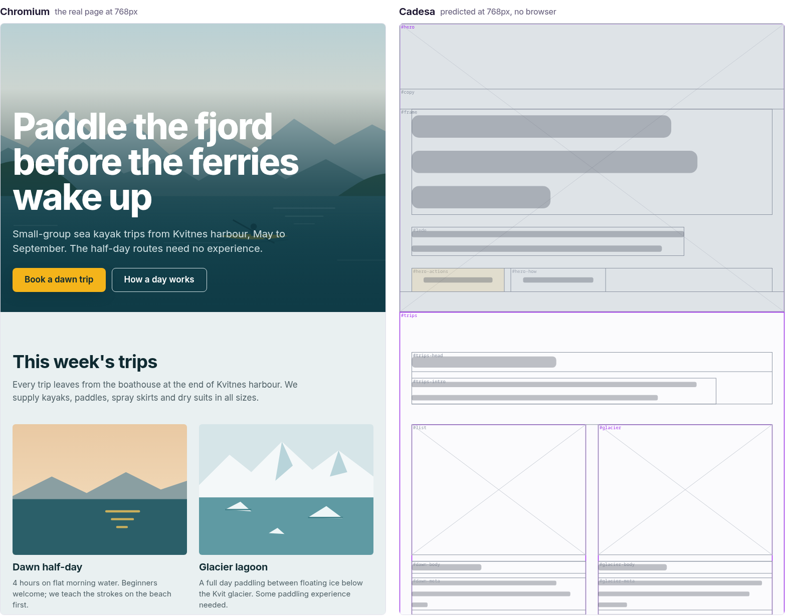

# Cadesa

[](https://github.com/soma-ck/cadesa/actions/workflows/ci.yml)
[](https://www.npmjs.com/package/cadesa)
[](LICENSE)

**Know what your layout does at every width before you open a browser.**

Point Cadesa at your coding agent (MCP), your existing CSS or your Tailwind page, and it tells you what breaks at 320px, what an edit will move three sections away, and where the design is muddled. It answers in milliseconds, as text, from a layout engine that runs without a browser and matches Chromium box for box.


## What Cadesa sees



<sub>Left: [`examples/landing`](examples/landing) in Chromium at 768px. Right: what Cadesa predicts for the same page, without a browser, drawn with `cadesa render --svg`. Every box, and every bar standing in for a line of text, is where Chromium puts it: all 5,412 boxes across 123 widths match (`npm run conformance:landing`).</sub>

Agents get the same information as text: every box's position and size, every wrapped line with its width, and for each value, the line of source that set it.

## Structure here, polish anywhere

Cadesa is for the **structural** part of CSS: everything that decides where a box goes and how big it is. That's the part that breaks at one width and not another, and the part you can't judge from one screenshot. The rest is **polish**: colors, gradients, shadows, hover states, transitions. Polish never moves a box, so it can go on top in whatever you already use, written by you or an agent, without risking the layout.

| Structure: let Cadesa check it | Polish: style it freely on top |
| --- | --- |
| layout (stack, wrapping rows, grids, layers), gaps, padding, margins | colors, gradients, background images |
| widths, max-widths, heights, aspect ratios | shadows, border colors, border radius, opacity |
| breakpoints | hover, focus and active states |
| font family, size, weight, line height, letter spacing, case | transitions, animations, transforms |
| text wrapping, long words | cursor, outlines, text color (but run `check` for contrast) |

The rule of thumb: **if it can move a box, it's structure.** Some things that look like decoration are structural for that reason. A border's *width*, a heavier font weight, letter spacing or uppercase all change sizes or line breaks, so they belong on the left.

A good loop for an agent: get the structure right with Cadesa (`check` and `critique` clean at every width, `whatif` before each change), then layer the visual design on top. Cadesa can describe polish too (`backdrop`, `shadow`), but it never has to.

## Try it in 60 seconds

Nothing to install: `npx` fetches it from npm. Node 20 or newer.

**Give it to your agent.** Claude Code:

```sh
claude mcp add cadesa -- npx -y cadesa mcp
```

Cursor and other MCP clients: `{"mcpServers": {"cadesa": {"command": "npx", "args": ["-y", "cadesa", "mcp"]}}}`. The server teaches the agent the render → explain → whatif → edit loop, so you can ask "check this page at every width" or "what else moves if I change this?"

**Run it on a page you already have,** with its CSS or the CSS Tailwind compiled for it:

```sh
npx -y cadesa check page.html --css styles.css
npx -y cadesa check page.html --css bootstrap.css,app.css   # a framework plus your own CSS
npx -y cadesa check page.html --tailwind compiled.css
```

```console
$ cadesa check fixtures/bootstrap/dashboard.html --css fixtures/bootstrap/bootstrap.css,fixtures/bootstrap/app.css
...
✖ [contrast] <span.stat-delta.text-success> text #198754 on #f4f6f9 is 4.18:1; WCAG AA needs 4.5:1 · at all 57 widths
    element: fixtures/bootstrap/dashboard.html:55 <span class="stat-delta text-success"> "+4.2% on last week"
    color: fixtures/bootstrap/bootstrap.css:8503 .text-success { color: rgba(var(--bs-success-rgb), var(--bs-text-opacity)); --bs-text-opacity: 1 }
           fixtures/bootstrap/bootstrap.css:7 :root { --bs-success-rgb: 25, 135, 84 }
    background (on <div.card.stat-card>): fixtures/bootstrap/bootstrap.css:4359 .card { background-color: var(--bs-card-bg); --bs-card-bg: var(--bs-body-bg) }
                                          fixtures/bootstrap/app.css:8 :root { --bs-body-bg: #f4f6f9 }
```

Each finding names the element (its line in the page, tag, classes and the start of its text) and the rules in your stylesheets that set the property behind it, following `var()` to where the variable is set. `--json` has the same, plus the path in the generated Cadesa source (`path`).

`check` sweeps every 20px from 320 to 1440px by default. With `--css`, Cadesa reads the page the way the browser does: your stylesheet, `<style>` blocks, `style` attributes and the browser's own defaults, matched with real selectors and ordered by specificity at every breakpoint, with block flow, collapsing margins, percentage widths and inherited text. It also understands what Bootstrap 5 and Angular pages are built from: the grid (negative gutters, `.col` growth, `col-*` and `row-cols-*` widths), `.container` max-widths that disappear on phones, `d-flex` rows with `justify-content` and auto margins, per-side padding and borders, form controls, and Angular's component elements. Anything it can't model (tables' heights, floats, and buttons aligned to a line of text, which need font vertical metrics) is marked `≈` with the rule responsible, and findings there are reported as *inconclusive* rather than guessed. `render`, `whatif`, `explain` and `critique` take `--css` and `--tailwind` too.

### Pages rendered by JavaScript: `capture`

An Angular, React or Vue app has no HTML file to check until it runs. `capture` loads the page in Chromium, waits for it to render and saves what it rendered:

```sh
npx -y cadesa capture http://localhost:4200/orders --out capture --wait app-orders
npx -y cadesa capture https://staging.example.com/orders --login-script login.mjs   # behind a login
```

It writes `page.html` (the rendered DOM, with scripts removed), every stylesheet in cascade order under `css/` (linked files, `@import`s inlined where they were, `<style>` blocks, and CSS-in-JS rules read back from the browser when the `<style>` element has no text), and the font files the page loaded under `fonts/`. Then it prints the `cadesa check page.html --css ...` command to run on them. A login script is a module that exports `async (page) => {}` (a Playwright page) and runs before the URL is loaded. Cookies and storage are not saved, and password and hidden input values are removed from the page.

### Confirm in Chromium: `--verify`

`cadesa check page.html --css ... --verify` runs the sweep, then loads the page in Chromium at every width with a finding (and six without), measures the elements the findings are about and marks each one:

```console
$ cadesa check fixtures/verify/page.html --css fixtures/verify/page.css --widths 400,800 --verify
✖ [tap-target] <button.close> is 20×20px; WCAG 2.5.8 needs at least 24×24px · at 400, 800px
    element: fixtures/verify/page.html:10 <button class="close"> "x"
    size: fixtures/verify/page.css:23 .close { width: 20px; height: 20px }
    chromium: confirmed at 400, 800px (20×20px)
...
not reproduced in Chromium (no problem there at the widths it loaded):
○ [tap-target] <button.zoomed> is 20×20px; WCAG 2.5.8 needs at least 24×24px · at 400, 800px
    element: fixtures/verify/page.html:10 <button class="zoomed"> "+"
    size: fixtures/verify/page.css:33 .zoomed { width: 20px; height: 20px }
    chromium: not reproduced at 400, 800px (60×60px)

2 errors, 1 warning, 1 not reproduced in Chromium (distinct issues across 400, 800px)
verified in Chromium 153.0.8010.52 at 2 widths (2 with findings, 0 without)
  boxes marked exact: 10 of 12 match Chromium within 0.5px · boxes marked ≈: 2 of 2 match
```

Inconclusive findings are decided by what Chromium measures: on `fixtures/bootstrap/orders.html` both inconclusive contrast findings come back confirmed. Tap targets, contrast, horizontal overflow, unbreakable words and text taller than a fixed height are measured; other findings stay as predicted. The last lines compare every box the engine laid out with Chromium's at those widths. `--verify` needs Playwright and a Chrome or Chromium, like `metrics --measure`.

**Or try the examples:**

```sh
git clone https://github.com/soma-ck/cadesa && cd cadesa && npm install
npx cadesa whatif fixtures/settings.html --source settings.cadesa.yaml --set styles.settings-panel.when.narrow.padding=panel
npx cadesa render examples/landing/landing.html --source examples/landing/landing.cadesa.yaml --widths 768 --svg landing.svg
```

<details>
<summary>Install notes</summary>

- In a project: `npm i -D cadesa`, then `npx cadesa ...`.
- The latest commit: `npx -y --allow-git=all github:soma-ck/cadesa ...` (npm 12 needs `--allow-git` for git installs).
- From a checkout: `npm run build:ts && claude mcp add --scope user cadesa -- node /path/to/cadesa/lib/cli.js mcp`.
- A browser is only needed for `cadesa capture`, `check --verify`, `cadesa metrics` and the conformance suites: `npm i -D playwright`, then `npx playwright install chromium` or set `$CADESA_CHROME` to an installed Chrome or Chromium.

</details>

## What it found on a real site

An agent rebuilt a 20-component French-language WordPress site in Cadesa, checking every edit at 12 or more widths, in 60–900ms per check. It found bugs nobody had asked it to look for, most of them visible only at some widths:

- A long word overflowing a card by **7.4px, only at 1100, 1280 and 1440px**.
- A link **23.8px tall**, 0.2px under the WCAG 2.5.8 minimum of 24px.
- Lines over 80 characters **only at tablet widths**, and an overflow at **300px** introduced by a cleanup.
- `whatif` stopped a fix to one card from **collapsing the footer from 4 columns to 3, three sections away** (footer height 437 → 682px).
- `critique` flagged **15 font sizes**, several only 1.08× apart. Consolidating to 7 visibly sharpened the hierarchy.

## What it does

| Command / MCP tool | Question it answers |
| --- | --- |
| `whatif` · `cadesa_whatif` | If I make this edit, what moves at each width, and does anything regress? Runs in memory, writes nothing. |
| `check` · `cadesa_check` | Is anything overflowing, too small to tap or low contrast, at any width? `--verify` confirms each finding in Chromium. |
| `critique` · `cadesa_critique` | Does it read as designed: type scale, hierarchy, grouping, alignment, palette? |
| `explain` · `cadesa_explain` | Why is this value what it is, and which line do I edit? |
| `render` · `cadesa_render` | Where is every box and every wrapped line? (`--lines` lists the lines, `--svg` draws the wireframe above.) |
| `lift` · `cadesa_lift` | Convert existing CSS to Cadesa. What couldn't be converted, and which boxes does that affect? |
| `build` · `cadesa_build` | Compile a Cadesa source to plain CSS. |
| `capture` · `cadesa_capture` | Save a page rendered by JavaScript (DOM, stylesheets, fonts) so `check` can read it. |

Add `--json` to any command for machine-readable output.

**`whatif`:** one proposed edit, every box it moves, the line that explains each new value, and proof that other widths didn't move:

```console
$ cadesa whatif fixtures/settings.html --source settings.cadesa.yaml --set styles.settings-panel.when.narrow.padding=panel
390px · narrow active
  #panel       padding 16px → 32px
                 ← space.panel = 2rem ← when.narrow (390px ≤ 576px) ← styles.settings-panel.when.narrow.padding
  #title       x 16 → 32  y 16 → 32  w 358 → 326
  ...
1280px
  ✓ unchanged: no box moved, no property changed
```

**`check`** covers overflow (horizontal, unbreakable words, text taller than a fixed height), text cut off by `overflow: hidden` or an ellipsis, text that runs together (`<span>Total</span><span>42</span>`), tap targets (WCAG 2.5.8 and 2.5.5), and contrast against the nearest painted background (every stop of a gradient, translucent colors blended, inline `<span>`s and badges in their own color). Content scrolling inside a scroll container (`.table-responsive`) isn't an overflow, and elements hidden at a width (`d-none`, a collapsed navbar menu) aren't laid out or reported there. Text over an image, or a background Cadesa can't see, comes back *inconclusive*, not passed; so does a size-dependent finding on a box whose size isn't exactly predicted (a box that only moves keeps its findings).

**`critique`** asks whether the page reads as designed, from measurable signals rather than taste: font sizes within 1.12× of each other (they read as one level), headings that barely stand out, groups spaced as far apart inside as outside, text edges that *almost* line up, a palette with no hue or competing accents, and common template tells. Findings are suggestions with numbers and a source line:

```console
$ cadesa critique fixtures/settings-long.html --source settings.cadesa.yaml
◇ [palette] every color in use is a grey, near-black or near-white (#ffffff, #191b20, #555964); with no hue
  anywhere the page reads as unbranded. One accent, from the subject, on the main action is usually enough
```

## Benchmarks

**Speed: 12–17× faster than driving a browser.** Getting every box of a page at every width, on one laptop core, both sequential, both producing the same boxes:

| Job | Cadesa | Playwright + Chromium |
| --- | --- | --- |
| [`examples/landing`](examples/landing), 113 widths (every 10px) | **0.76s** | 9.44s |
| Same page, **every pixel** from 320 to 1440 (1,121 widths) | **6.2s** | 75.9s |
| [`examples/pricing`](examples/pricing), 113 widths | **0.31s** | 5.40s |

That's why checking every width on every edit is practical. It covers geometry only; pixel diffs and interaction tests still need a browser. Reproduce with `npm run speed`.

**Agents: catching what nobody described.** Agents (`sonnet`, Claude Code 2.1.327) got a realistic change request for a six-section page and were **not told where it breaks**. A judge measured what they shipped in Chromium at 58 widths, 8 trials per arm per task. "Clean" means no layout defect and nothing moved in a section the request didn't touch.

| Task | Plain CSS + screenshots | Cadesa |
| --- | --- | --- |
| Translate the page to German | 0 of 8 clean | **8 of 8 clean** |
| Add a fourth pricing plan | **8 of 8** | 5 of 8 |
| Make the text bigger | 7 of 8 | 8 of 8 |
| **All** | 15 of 24 · $0.21 per trial | **21 of 24 · $0.18 per trial** |

The gap is one task (p ≈ 0.0002). After the German translation, `cadesa check` named two overflows that existed only at some widths, and every Cadesa agent fixed them with two edits. The CSS agents couldn't see what was broken, so they patched defensively and changed 21–56 boxes in sections that already worked, or left an overflow. Cadesa lost the fourth-plan task to two gaps that are now fixed: long words couldn't break (now `wrap: anywhere`), and `check` only looked at the widths it was given (it now sweeps every 20px). One model, one page, three tasks chosen by Cadesa's authors; every trial is in [`bench/RESULTS.md`](bench/RESULTS.md).

## How exact is "exact"?

The engine ([`src/engine/`](src/engine/)) is the spec: its box tree depends only on the source, the HTML and the width. That it matches Chromium is checked, not assumed. Every suite below loads the pages in Chromium with the exact CSS bytes and compares every box, x, y, width and height within 0.5px, so a text that wrapped to a different number of lines fails by a whole line height. All of them run in CI.

| Suite | What it covers | Result |
| --- | --- | --- |
| `npm run fuzz` | **differential fuzzer**: random pages covering the whole language | 39,597 pages at 148,328 widths: **688,902 boxes, 0 disagreements** (0 again on fresh seeds) |
| `conformance:tailwind` | three Tailwind pages through `--tailwind` | all 19,056 boxes marked exact match (400 left `≈`) |
| `conformance:bootstrap` | six Angular + Bootstrap 5.3.8 pages, with the real `bootstrap.css` (navbar collapse, grid, cards, tables, `d-*` utilities) | all 13,303 boxes marked exact match; one page fully exact, the rest held back mostly by font vertical metrics. Where a box is `≈` but `check` treats its size as known, the size matches too |
| `conformance:css` | plain CSS through `--css`: an app side panel, an article, a dashboard, scroll and clip containers, lone buttons and transforms | all 9,912 boxes marked exact match, every 10px from 320 to 1440px |
| `conformance:fonts` | Roboto (variable, from Google Fonts) and Lato (two static faces via `@font-face`) | 5,474 of 5,474, and the line count of all 4,347 text boxes, over 161 widths |
| `conformance:landing` | grid, text over images, aspect ratios, gradients | 5,412 of 5,412 over 123 widths |
| `conformance:pricing` | nested components | 4,290 of 4,290 over 143 widths |
| `conformance:field2` | every divergence found in real use, kept fixed | 2,576 of 2,576 over 161 widths |
| `conformance:sweep` | long copy every 3px, to land on line-break boundaries | 1,482 of 1,482 over 247 widths |
| `conformance:lift` | a hand-written BEM stylesheet vs the original | all 28 boxes match, none left uncertain |

Real use has caught Cadesa wrong before: the site rebuild above found seven cases where it said "fine" and Chromium disagreed. Each was fixed and kept as a regression test, and the fuzzer then found and fixed the next ones, mostly in exactly how Chromium rounds text widths and picks line breaks (59 regression cases in [`fixtures/fuzz`](fixtures/fuzz)). Where Chromium's choice hinges on a fraction of a pixel, the box is flagged rather than guessed. Testing on Bootstrap pages also caught one released bug: 0.1.6 predicted an empty Angular `<router-outlet>` as full width instead of 0×0, and every box after it was off. 0.1.7 fixes it, and the Bootstrap suite keeps it fixed.

**Fonts.** Text is measured from per-font tables of glyph widths and kerning, measured once in Chromium. Cadesa bundles them for **Inter, Roboto, Open Sans, Montserrat, Lato, Poppins, Source Sans 3, Nunito and Raleway**, so those work with no setup. For any other font:

```sh
cadesa fonts page.html --css styles.css            # which fonts the text uses, and where each comes from
cadesa fonts page.html --css styles.css --measure  # measure them all (needs Playwright + Chrome/Chromium)
cadesa metrics --google "Work Sans"                # or a Google font by name
```

`cadesa fonts` finds each family's `@font-face` file or Google Fonts link, measures the exact files the page loads, and writes `.cadesa/metrics/<family>.metrics.json`; commit it. Agents can do the same with the `cadesa_fonts` MCP tool. System fonts (Arial, Segoe UI, `system-ui`) differ by machine: reports say so, and `--system` measures this machine's, marked machine-specific. Text in a font without metrics, or with characters outside the measured Latin set, falls back to a one-line assumption, and every report flags that box. No hyphenation, `text-wrap: balance` or bidirectional text yet.

## Why a language

CSS layout is emergent: cascade, specificity, inheritance and intrinsic sizing all interact, so the usual way to know what an edit does is to render it. Cadesa is a styling language deliberately small enough to simulate exactly: no cascade, no inheritance, four layout patterns, and a named token for every value. That's what makes exact prediction possible, and why every number in a report points at the line that produced it. It compiles to plain, readable CSS with no runtime.

```yaml
tokens:
  space: { section: 1.5rem, panel: 2rem, compact: 1rem, control: 0.75rem }
  color: { surface: "#ffffff", ink: "#191b20", muted: "#555964" }
text:
  section-title: { size: 1.5rem, weight: 650, lineHeight: 1.2, color: ink }
breakpoints:
  narrow: 36rem
styles:
  settings-panel:
    layout: { pattern: stack, gap: section }
    padding: panel
    slots:
      title: { text: section-title }
      actions: { layout: { pattern: cluster, gap: control } }
    when:
      narrow:
        padding: compact
        slots:
          actions: { layout: { pattern: stack, gap: control } }
```

Write it the way you would anyway: `version` is optional, names can be kebab-case or camelCase, a plain number is px, line heights can be `1.5`, `"24px"` or `"150%"`, and colors can be hex or `rgb()`. Errors name the file, line, field and expected values, with a "did you mean". The same input always compiles to byte-identical CSS. Add `# yaml-language-server: $schema=./schema/cadesa.schema.json` for editor autocomplete. Full example: [`settings.cadesa.yaml`](settings.cadesa.yaml) → [`dist/settings.css`](dist/settings.css).

**Already have CSS?** `cadesa lift styles.css --out styles.cadesa.yaml` converts component-style CSS (`.block`, `.block__element`) and `lift --tailwind page.html --css compiled.css` converts a Tailwind page. Whatever doesn't convert is reported per box, with the rule responsible, not as a coverage percentage: a `:hover` rule moves nothing, while one `min-width` query can move every box at the widths where it applies.

## Language reference

| Key | Value | Compiles to |
| --- | --- | --- |
| `layout.pattern: stack` | | `display:flex; flex-direction:column; align-items:stretch` |
| `layout.pattern: cluster` | | `display:flex; flex-wrap:wrap; align-items:center` |
| `layout.pattern: grid` + `min` | size token | `grid-template-columns: repeat(auto-fill, minmax(min(<min>, 100%), 1fr))` |
| `layout.pattern: layer` | | one grid cell holding every child: text over a photo, a badge over a card |
| `layout.pattern: flow` | | ordinary block flow (`display: block`): children stack, vertical margins collapse as in the browser |
| `layout.gap` | space token | `gap` |
| `layout.align` | `start`, `center`, `end`, `stretch` | `align-items` (cluster defaults to `center`, grid and layer to `stretch`; not for stack) |
| `layout.justify` | `start`, `end`, `center`, `between`, `around`, `evenly` | `justify-content` in a cluster, distributed as Chromium does |
| `layout.wrap` | `false` | a one-line row (`flex-wrap: nowrap`) whose items shrink to fit |
| `grow` | `{ factor, basis: zero \| auto }` | `flex: <factor> …`: items share a row's free space (Bootstrap's `.col`, Tailwind's `flex-1`) |
| `padding` | space token, or `{ block, inline }` | `padding` (a missing axis is 0) |
| `margin` | space token (negative allowed), `auto`, `{ block, inline }` or `{ top, right, bottom, left }` | `margin`; collapses between blocks in `flow`, adds to the outer size in stacks, rows and grids |
| `width` | size token (px, rem or `"50%"`), `fill` or `fit` | fixed width, stretch in a stack, or `fit-content`. Unset: stretch in a stack, sized to its content in a cluster |
| `height` | size token | `height` |
| `maxWidth` | size token | a centered column (`max-width` + `margin-inline: auto`), e.g. content inside a full-bleed band |
| `measure` | size token | a left-aligned `max-width`: a comfortable line length |
| `aspect` | `"16:9"` | `aspect-ratio`: the height follows the width |
| `text` | text role | font family, size, weight, line height, color; optional `letterSpacing` (em), `transform: uppercase`, `decoration`, `wrap: anywhere` (long words break) |
| `overflow` | `hidden`, `clip`, `auto`, `scroll`, or `{ x, y }` | `overflow-x` / `overflow-y`: what doesn't fit scrolls or is cut off. Anything but `clip` also keeps the children's margins inside and lets the box shrink below its content in a cluster |
| `textAlign` | `start`, `center`, `end` | `text-align` (fixed-height text is also centered vertically) |
| `border` | color token, or `{ color, width, top, right, bottom, left }` | `border` with per-side widths (they count in layout, so it's structure) |
| `background`, `radius`, `backdrop`, `shadow`, `fit` | tokens | polish: `background-color`, `border-radius`, `background-image`, `box-shadow`, `object-fit` |
| `when.<breakpoint>` | any of the above, plus `slots` | `@media (max-width: …)`; each listed property replaces its base value, and the narrowest active breakpoint wins |
| `none` in `when` | e.g. `maxWidth: none` | removes a base value at a breakpoint (`.container` below 576px) |
| `page.background` | color token | `:root { background-color }`, so contrast checks are conclusive |

**Components nest:** put a `.ca-plan-card` inside `.ca-pricing__plans` and the card lays out its own slots and breakpoints inside the parent's layout ([`examples/pricing`](examples/pricing)). Classes are `.ca-<component>` and `.ca-<component>__<slot>` (`prefix: ""` drops the `ca-`). The compiled CSS is plain, framework-free and has no runtime, so it works in React, Vue, Svelte or static HTML ([`examples/vue`](examples/vue)).

## Roadmap

- **Font vertical metrics** (ascent, descent, x-height), so inline-blocks centred on a line of text (most lone buttons) and inline spans become exact. This is the biggest remaining cause of `≈` on Bootstrap pages.
- **Tables, floats,** explicit grid templates and percentage padding, which are reported as `≈` today.
- **More of Tailwind:** `dark:` and container queries.

## Development

```sh
npm test && npm run typecheck   # unit tests, including the fuzzer's regression corpus
npm run conformance:css         # any conformance suite above (needs Chrome or Chromium)
npm run fuzz -- --cases 2000    # differential fuzzer against Chromium
npm run speed                   # engine vs Playwright
npm run bench                   # agent benchmark (uses the claude CLI and model usage)
```

## License

Cadesa's source code is [MIT](LICENSE). The bundled Inter font is under the [SIL Open Font License 1.1](fonts/OFL.txt).

**The CSS you generate is yours.** Running the compiler doesn't place your `.cadesa.yaml` sources or the CSS it emits under the MIT license or any other Cadesa license. License your output however you like, including proprietary.
