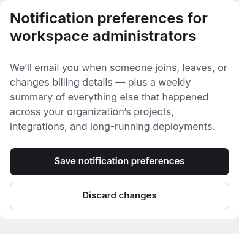
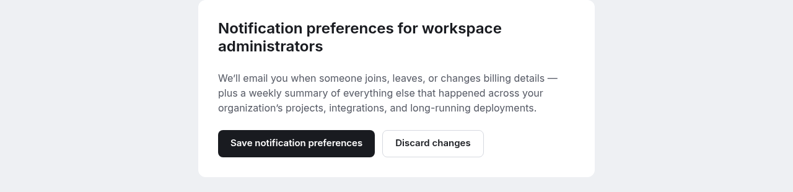

# Cascadio

**Predict what a style edit will do before you make it.**
Cascadio computes layout without a browser and ships plain CSS.

```console
$ cascadio whatif fixtures/settings.html --source settings.cascade.yaml \
    --set styles.settings-panel.when.narrow.padding=panel

whatif styles.settings-panel.when.narrow.padding: compact → panel
(in memory, nothing written · computed in 22ms, no browser)

390px · narrow active
  #panel       padding 16px → 32px
                 ← space.panel = 2rem ← when.narrow (390px ≤ 576px) ← styles.settings-panel.when.narrow.padding
               h 232.8 → 264.8
  #title       x 16 → 32  y 16 → 32  w 358 → 326
  #description x 16 → 32  y 68.8 → 84.8  w 358 → 326
  #actions     x 16 → 32  y 116.8 → 132.8  w 358 → 326
  #save        x 16 → 32  y 116.8 → 132.8  w 358 → 326
  #cancel      x 16 → 32  y 172.8 → 188.8  w 358 → 326

1280px
  ✓ unchanged: no box moved, no property changed
```

One proposed edit, every affected box, the YAML path that explains each value, and proof that desktop didn't move. An agent can read that and decide *before* it touches a file.

| 390px | 1280px |
| --- | --- |
|  |  |

<sub>Screenshots are from the Chromium conformance run, loading the exact CSS bytes `cascadio build` wrote. The engine predicted every line break shown here, without a browser.</sub>

## Why

Agents write CSS blind. CSS layout is emergent (cascade, specificity, inheritance, intrinsic sizing), so the only way to know what an edit does is to render it in a browser. That answer comes *after* the edit, takes seconds, and arrives as pixels that language models read poorly.

Cascadio is a styling language deliberately small enough to simulate exactly: no cascade, no inheritance, two layout patterns, and named tokens for every value. Its reference engine is a few hundred lines of TypeScript. It answers in milliseconds as **text**: box geometry, the provenance chain for each value, and a diff between before and after.

Production gets ordinary, readable CSS with no runtime.

## Quick start

```sh
npm install
npm run cascadio -- build settings.cascade.yaml --out dist/settings.css
npm run cascadio -- render fixtures/settings.html --source settings.cascade.yaml --widths 390,1280
npm run cascadio -- whatif fixtures/settings.html --source settings.cascade.yaml --widths 390,1280 \
  --set styles.settings-panel.when.narrow.padding=panel
```

Add `--json` to any command for machine-readable output.

### Ask why a value is what it is

```console
$ cascadio explain fixtures/settings.html --source settings.cascade.yaml --id panel --widths 1280
#panel <section> at 1280px
  box 320,0 640×208.8 · style styles.settings-panel

  padding     32px
                set at styles.settings-panel.padding
                  from space.panel = 2rem
                ○ when.narrow (max-width: 36rem (576px)): compact (16px)  styles.settings-panel.when.narrow.padding
  ...
```

`○` marks an override that isn't active at this width but would take over below 576px.

### See where text wraps

```console
$ cascadio render fixtures/settings-long.html --source settings.cascade.yaml --widths 390 --lines
    #description  p        16,97.6   358×120    text body-muted · 5 lines
                  │ We’ll email you when someone joins, leaves, or  (354.87px)
                  │ changes billing details — plus a weekly  (295.56px)
                  │ summary of everything else that happened  (324.4px)
                  │ across your organization’s projects,  (267.78px)
                  │ integrations, and long-running deployments.  (335.12px)
```

### Check it

With `muted` lightened to `#aab0bb`:

```console
$ cascadio check fixtures/settings.html --source settings.cascade.yaml --widths 1280
1280px
  ✖ [contrast] #description text #aab0bb on #ffffff is 2.18:1; WCAG AA needs 4.5:1 (background from styles.settings-panel.background)
      edit: text.body-muted.color
```

`check` covers overflow (horizontal, unbreakable words, and text taller than a fixed height), tap targets (WCAG 2.5.8 and 2.5.5), text contrast against the nearest Cascadio background, and line length. When the source can't decide a check, for example because the page background sits outside Cascadio, it says *inconclusive* rather than guessing.

## Use it from your agent (MCP)

Cascadio ships an MCP server, so Claude Code, Cursor, Codex and other MCP clients can call it directly:

```json
{
  "mcpServers": {
    "cascadio": { "command": "npx", "args": ["-y", "cascadio", "mcp"] }
  }
}
```

| Tool | What it answers |
| --- | --- |
| `cascadio_whatif` | "If I make this edit, what moves at each width, and does anything regress?" Runs in memory and writes nothing. |
| `cascadio_render` | "Where is every box, and where does the text wrap?" |
| `cascadio_explain` | "Why is this value what it is, and which YAML path do I edit?" |
| `cascadio_check` | "Is anything overflowing, too small to tap, or low contrast?" |
| `cascadio_lift` | "Turn this existing CSS into Cascadio. What couldn't be converted, and which boxes does that affect?" |
| `cascadio_validate` / `cascadio_css` / `cascadio_build` | Validate, preview the CSS, write the CSS. |

Every read tool accepts `sourceText`, so an agent can evaluate an unsaved draft, or `css` to work directly on existing CSS. The server's instructions teach the language and the render → explain → whatif → edit loop. This repo includes a [`.mcp.json`](.mcp.json) that runs the server from source.

## Already have CSS? Lift it

`cascadio lift` converts plain BEM-style CSS (`.block`, `.block__element`) into a Cascadio source. Whatever doesn't fit isn't guessed. It is reported per box: for each width, which boxes the engine still predicts exactly, which may differ from the original CSS, and which declaration or browser default is responsible.

```console
$ cascadio lift fixtures/legacy.css --fixture fixtures/legacy.html --widths 390,1280 --out legacy.cascade.yaml
lift fixtures/legacy.css: 49 of 54 declarations lifted · 1 component · 17 tokens · 1 breakpoint

box impact (≈ = may differ from the original CSS)
390px
  ✓ exact (5): #name #bio #actions #follow #message
  ≈ #meta size
      fixtures/legacy.css: <p> keeps the browser's default margin (no margin set); Cascadio's reset removes it
  ≈ #badge size+position
      fixtures/legacy.css:78 position: absolute: position: absolute takes the box out of normal flow
  · no effect in the default state: fixtures/legacy.css:59 background: #1d4ed8: interactive state
1280px
  ✓ exact (0): none
  ≈ #name size
      fixtures/legacy.css:106 max-width: 560px: @media (min-width: 1024px) is not modelled
  ...
```

A `:hover` rule can't move anything in the default state, while a `min-width` query moves every box at the widths where it applies. A coverage percentage would hide that difference, so lift reports per box instead.

Every read command and MCP tool also accepts `--css <file.css>` in place of `--source`. The CSS is lifted on the fly, uncertain boxes are marked `≈`, and `check` findings on them are reported as inconclusive.

**Verified against Chromium:** `npm run conformance:lift` loads the fixture with the *original* hand-written CSS. Every box lift marked exact matched, 15 of 15 at 0.000–0.011px. Every box it marked uncertain really did differ, 17 of 17. Lifting Cascadio's own output gives back the same source, and a test checks that its layout is identical at 49 widths.

## The source

```yaml
version: 1
tokens:
  space: { section: 1.5rem, panel: 2rem, compact: 1rem, control: 0.75rem }
  color: { surface: "#ffffff", ink: "#191b20", muted: "#555964" }
text:
  section-title: { size: 1.5rem, weight: 650, lineHeight: 1.2, color: ink }
breakpoints:
  narrow: 36rem
styles:
  settings-panel:
    intent: Give the heading and save action the strongest visual hierarchy.
    layout: { pattern: stack, gap: section }
    padding: panel
    slots:
      title: { text: section-title }
      actions: { layout: { pattern: cluster, gap: control } }
    when:
      narrow:
        padding: compact
        slots:
          actions: { layout: { pattern: stack, gap: control } }
```

The full example is in [`settings.cascade.yaml`](settings.cascade.yaml), and the CSS it compiles to is in [`dist/settings.css`](dist/settings.css). Add `# yaml-language-server: $schema=./schema/cascadio.schema.json` to get editor autocomplete.

### Errors point at the field to edit

```console
$ cascadio build settings.cascade.yaml --out dist/settings.css
settings.cascade.yaml:19:36 error styles.settings-panel.layout.gap: unknown space token "sectoin"
  expected: one of section, panel, compact, control
  got: "sectoin"
  did you mean "section"?
```

Invalid source never produces CSS. The same input always produces byte-identical CSS.

## Language reference (v1)

| Key | Value | Compiles to |
| --- | --- | --- |
| `layout.pattern: stack` | | `display:flex; flex-direction:column; align-items:stretch` |
| `layout.pattern: cluster` | | `display:flex; flex-wrap:wrap; align-items:center` |
| `layout.gap` | space token | `gap` |
| `padding` | space token, or `{ block, inline }` | `padding` (a missing axis is 0) |
| `background`, `border` | color token | `background`, `border: 1px solid` |
| `radius` | radius token | `border-radius` |
| `width` | size token, or `fill` | fixed `width; flex:none`, or stretch in a stack. Unset: stretch in a stack, sized to its text in a cluster |
| `height` | size token | `height` |
| `maxWidth` (root only) | size token | `max-width; margin-inline:auto` |
| `text` | text role | font family, size, weight, line-height, color |
| `when.<breakpoint>` | any of the above, plus `slots` | `@media (max-width: …)` after base rules; replaces, never merges |
| `intent` | sentence | a CSS comment; metadata for inspection |

Class contract: `.ca-<component>` on the root and `.ca-<component>__<slot>` on slots. Set a top-level `prefix: ""` to drop the `ca-` (lift does this to keep existing class names). Slot rules are scoped to the root. Each component gets a scoped reset, so browser defaults can't move boxes the engine doesn't know about.

## How exact is "exact"?

There are two separate claims:

1. **The engine is the spec.** Cascadio's box tree is defined by its reference engine ([`src/engine/`](src/engine/)). It is deterministic and depends only on source, fixture and width.
2. **Chromium agrees, verified rather than assumed.** `npm run conformance` builds the CSS, serves each fixture, checks that the page loaded those exact bytes, and compares every `data-fixture` box against the engine, including wrapped line counts:

```
── fixtures/settings-long.html
320px (narrow active)
  ✓ #panel        0,0 320×410.4              0,0 320×410.39             0.009
  ✓ #title        16,16 288×86.4             16,16 288×86.39            0.009  3 lines / chromium 3
  ✓ #description  16,126.4 288×144           16,126.39 288×144          0.009  6 lines / chromium 6
  ...
1280px
  ✓ #save         352,209.6 253.19×44        352,209.59 253.2×44        0.010
  ✓ #cancel       617.19,209.6 163.47×44     617.2,209.59 163.47×44     0.010
✓ stylesheet: the fixture loaded dist/settings.css unchanged
✓ engine and Chromium agree on all 48 boxes
```

`npm run conformance:sweep` runs the long-copy fixture at **every 3px from 260 to 1000px (247 widths)**, so some widths land right on a line-break boundary. All 1,482 boxes agree within 0.5px, and every line count matches.

### How text is measured without a browser

Cascadio bundles [Inter](https://rsms.me/inter/) (SIL OFL 1.1) and a 136 KB metrics table: glyph advances and 13k kerning pairs, sampled at 9 weights and interpolated. `npm run metrics` regenerates the table, once, from Chromium's own text measurement. At runtime the engine reads only the JSON, with no font parser and no browser. Line breaking follows CSS `white-space: normal`: breaks after spaces, after hyphens between letters, and around dashes. Each component's reset pins the inherited text properties that could change line breaks (letter-spacing, word-spacing, text-transform, kerning and so on), so a host page can't change them behind the engine's back.

**Current limits:** measured text must use Inter and the Latin character set the table covers. Any other font, or a character outside the table, falls back to a one-line assumption, and every report flags that box. In a `cluster`, a box without a width is sized to its text (max-content, shrinking to min-content), the same way flexbox does it. No hyphenation, no `text-wrap: balance`, and no bidirectional text yet.

The conformance run uses a system Chrome or Chromium when one is found (or `$CASCADIO_CHROME`), otherwise Playwright's bundled browser. A browser is never needed to build, render, explain, check or `whatif`.

## Using the CSS in your app

The stylesheet is plain CSS. Here it is on a minimal Vue component ([`examples/vue/SettingsPanel.vue`](examples/vue/SettingsPanel.vue)):

```vue
<script setup lang="ts">
import "./settings.css";
defineEmits<{ save: []; cancel: [] }>();
</script>

<template>
  <section class="ca-settings-panel" aria-labelledby="notifications-title">
    <h2 id="notifications-title" class="ca-settings-panel__title">Email notifications</h2>
    <p class="ca-settings-panel__description">Pick what lands in your inbox.</p>
    <div class="ca-settings-panel__actions">
      <button class="ca-settings-panel__primary" type="submit" @click="$emit('save')">Save changes</button>
      <button class="ca-settings-panel__secondary" type="button" @click="$emit('cancel')">Cancel</button>
    </div>
  </section>
</template>
```

React, Svelte, server templates and static HTML work the same way, because Cascadio has no runtime.

## Roadmap

- **Bring your own font:** `cascadio metrics <font.woff2>` to measure any font the way Inter is measured.
- **More of CSS:** grid, `min-width` breakpoints, and a `row` pattern, so lift leaves less behind.
- **Benchmark:** agents fixing a mobile layout bug with Cascadio vs. plain CSS, on the same fixture with the same edit budget. It measures attempts to fix and desktop regressions.

## Development

```sh
npm test             # validation, determinism, golden CSS, engine, whatif
npm run typecheck
npm run conformance        # optional: engine vs. Chromium, 2 fixtures × 4 widths
npm run conformance:sweep  # optional: 247 widths, line-break boundaries
npm run conformance:lift   # optional: lifted hand-written CSS vs. the original in Chromium
```

## License

Cascadio's own source code is [MIT](LICENSE). The bundled Inter font is under the [SIL Open Font License 1.1](fonts/OFL.txt).

**The CSS you generate is yours.** Running the compiler does not place your `.cascade.yaml` sources or the CSS it emits under the MIT license or any other Cascadio license. License your output however you like, including proprietary.
